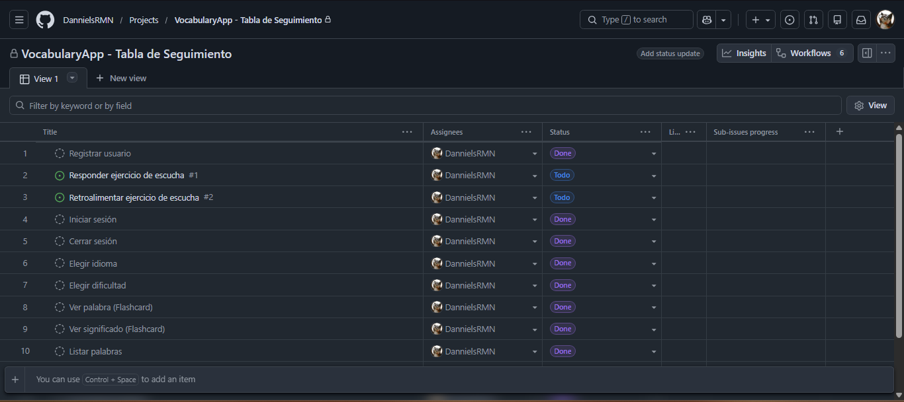
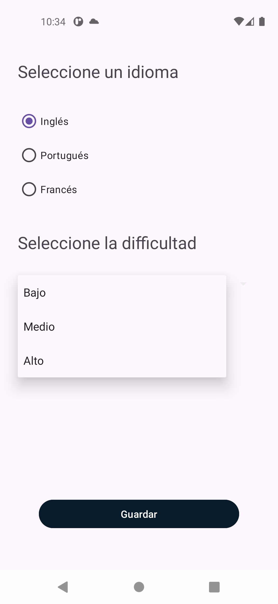
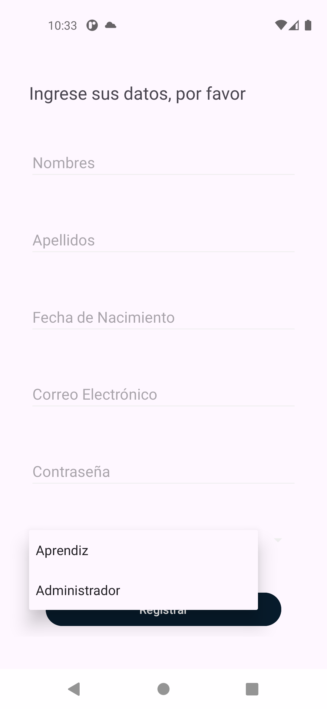
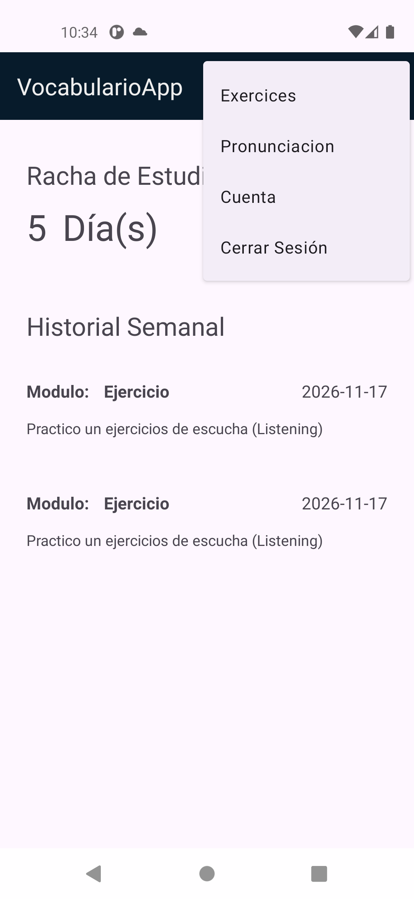
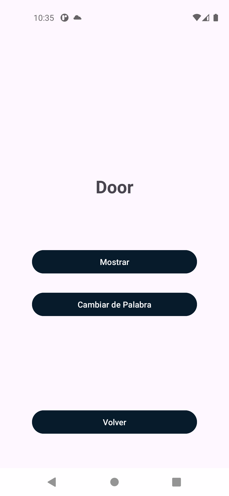
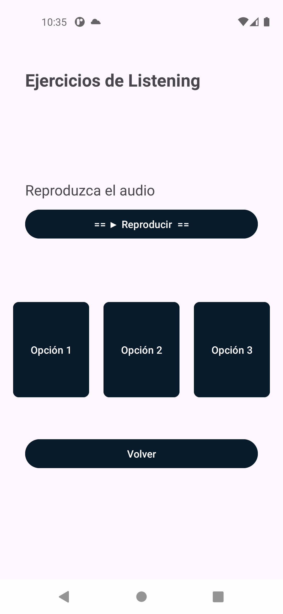
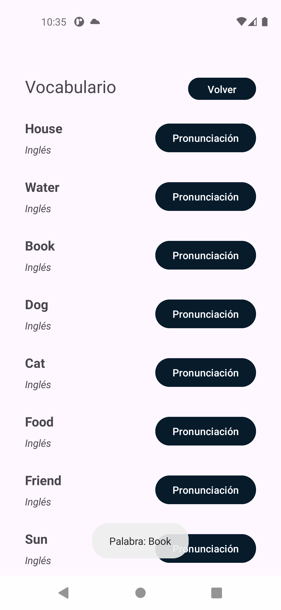
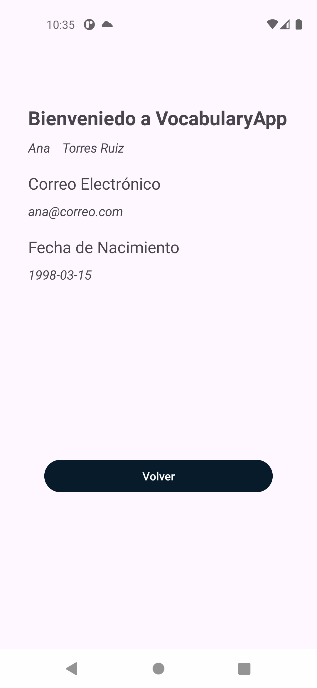

# ➔ Vocabulario_App
Aplicación móvil para el aprendizaje de vocabulario mediante ejercicios interactivos.

## ➔ Historial de Commits
Los avances están completamente documentos en los siguientes enlaces.
- [Ver commits del Hito 1](docs/historial_commits.md#hito-nro-1-05-noviembre)
- [Ver commits del Hito 2](docs/historial_commits.md#hito-nro-2-10-noviembre)
- [Ver commits del Hito 3](docs/historial_commits.md#hito-nro-3-17-noviembre)

## ➔ Bitácora Semanal
De igual forma se segmentará la bitácora de errores mediante los hitos.
- [Leer lecciones aprendidas (Hito 1)](docs/bitácora_semanal.md#hito-nro-1)
- [Leer lecciones aprendidas (Hito 2)](docs/bitácora_semanal.md#hito-nro-2)
- [Leer lecciones aprendidas (Hito 3)](docs/bitácora_semanal.md#hito-nro-3)

## ➔ Plan de Avance
El plan de avance nos permitirá conocer la distribución por porcentajes sobre el avance según de los requerimientos funcionales.

| Nro. | Requerimiento | Peso | Estado |
| :---: | :--- | :---: | :---: |
| 1 | Registrar usuario | 9% | Completo |
| 2 | Iniciar sesión | 9% | Completo |
| 3 | Cerrar sesión | 4% | Completo |
| 4 | Elegir idioma | 4% | Completo |
| 5 | Elegir dificultad | 3% | Completo |
| 6 | Ver palabra | 3% | Completo |
| 7 | Ver significado | 3% | Completo |
| 8 | Listar palabras | 9% | Completo |
| 9 | Reproducir pronunciación | 18% | Completo |
| 10 | Ver historial semanal | 7% | Completo |
| 11 | Ver progreso diario | 4% | Completo |
| 12 | Responder ejercicio de escucha | 9% | Pendiente |
| 13 | Retroalimentar ejercicio de escucha | 18% | Pendiente |
| | **Total** | **73%** | **En Progreso** |

## ➔ Tablero de Tareas
El progreso se presentará mediante una tabla para verificar los avances correspondientes.

| Estado | Cantidad |
| :--- | :---: |
| ✅ Completado | 11 |
| 🔄 En progreso | 0 |
| ⏳ Pendiente | 2 |
| **Total** | **13** |

[Project de VocabularyApp](https://github.com/users/DannielsRMN/projects/1)

## ➔ Vistas Logradas
### 1. MainActivity (Login)

### 2. ChooseActivity (Para Idioma y Dificultad)

### 3. RegisterActivity

### 4. HomeActivity

### 5. Flashcards

### 6. Ejercicios de Escucha

### 7. Vocabulario (Escucha de Pronunciación)

### 8. Información de la cuenta

## ➔ Video de Presentación
   