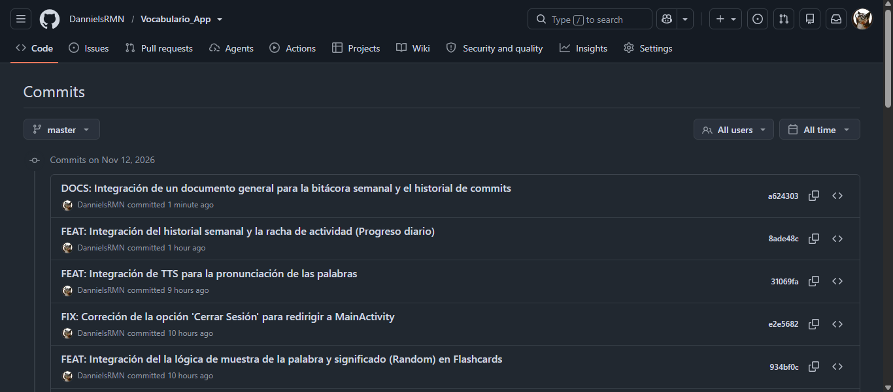
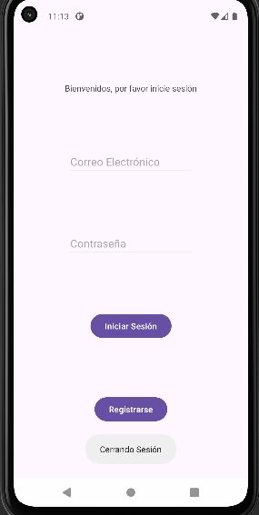
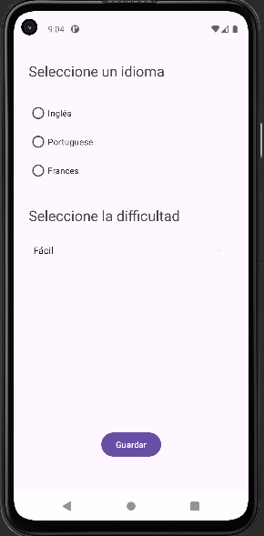
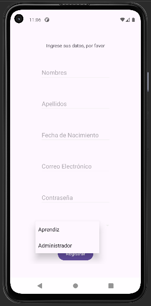
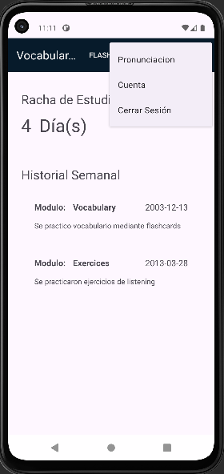
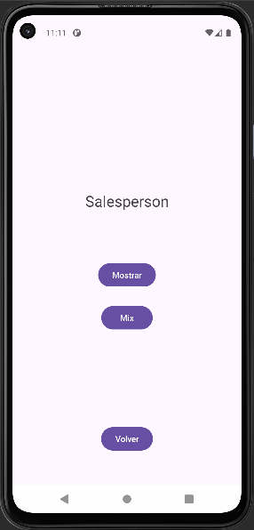
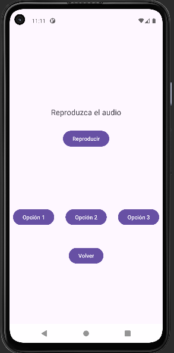
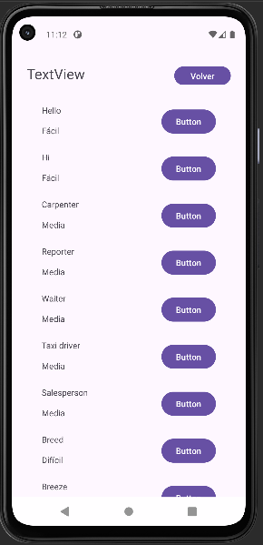
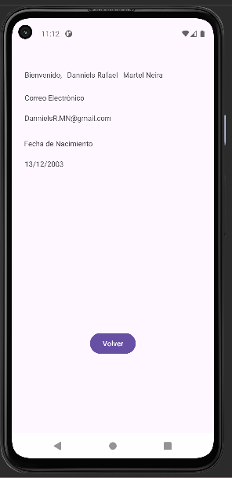

# Vocabulario_App
## Historial de Commits

[Leer el historial de Commits](docs/historial_commits.md)

## Bitácora Semanal
[Leer lecciones aprendidas](docs/bitácora_semanal.md)

## Plan de Avance
El plan de avance nos permitirá conocer la distribución por porcentajes sobre el avance según de los requerimientos funcionales.

| Nro. | Requerimiento | Peso | Estado |
| :---: | :--- | :---: | :---: |
| 1 | Registrar usuario | 5% | Completo |
| 2 | Iniciar sesión | 5% | Completo |
| 3 | Cerrar sesión | 2% | Completo |
| 4 | Elegir idioma | 2% | Completo |
| 5 | Elegir dificultad | 2% | Completo |
| 6 | Ver palabra | 2% | Completo |
| 7 | Ver significado | 2% | Completo |
| 8 | Listar palabras | 5% | Completo |
| 9 | Reproducir pronunciación | 10% | Completo |
| 10 | Ver historial semanal | 4% | Completo |
| 11 | Ver progreso diario | 2% | Completo |
| 12 | Responder ejercicio de escucha | 5% | Pendiente |
| 13 | Retroalimentar ejercicio de escucha | 10% | Pendiente |
| 14 | Registrar nueva palabra | 7% | Pendiente |
| 15 | Registrar nuevo ejercicio de escucha | 7% | Pendiente |
| 16 | Editar palabra | 10% | Pendiente | |
| 17 | Editar ejercicio de escucha | 10% | Pendiente |
| 18 | Eliminar palabra | 5% | Pendiente |
| 19 | Eliminar ejercicio de escuchar | 5% | Pendiente |
| | **Total** | **41%** | **En Progreso** |

## Vistas Logradas
### 1. MainActivity (Login)

### 2. ChooseActivity (Para Idioma y Dificultad)

### 3. RegisterActivity

### 4. HomeActivity

### 5. Flashcards

### 6. Ejercicios de Escucha

### 7. Vocabulario (Escucha de Pronunciación)

### 8. Información de la cuenta

