# Bitácora Semanal
## Hito Nro. 1

### 1. Constructor del Intent
- > **Fecha**: Jueves 05/11/2026
- > **Contexto**: Se presentó un error al indicar el origen y el destino de un intento implícito, a continuación el error capturado:
- >**Error**: Cannot resolve constructor 'Intent(OnClickListener, Class<RegisterActivity>)

**Antes**
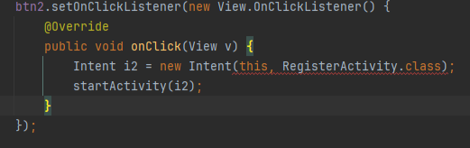

**Después**
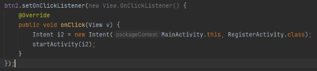

## Hito Nro. 2
### 1. Constructores de Usuarios
- > **Fecha**: Martes 10 -19:14
- > **Contexto**: Se encontró un error al momento de iniciar con la generación de la lógica de programación para el registro local de las credenciales en el register, debido a que en MainActivity solo se usan el correo y la contraseña para la validación, se generó un constructor previo antes para poder mantener la lógica anterior y poder adicionar la nueva.

**Solución**

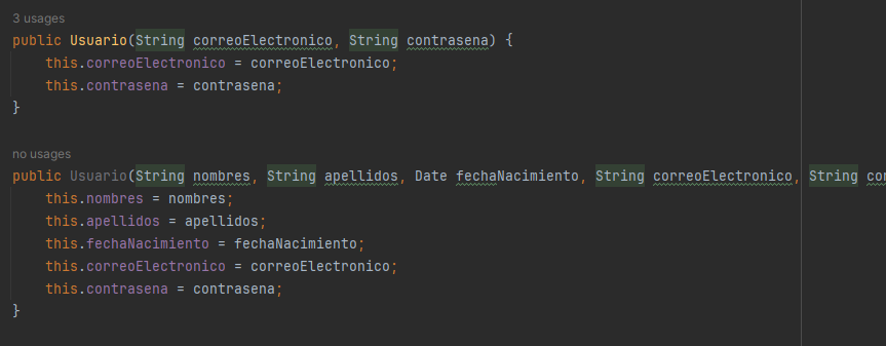

### 2. Listado privado
- > **Fecha**: Miércoles 11 - 10:55
- > **Contexto**: En la presentación del día Martes 10, se encontró que nuestra actividad de RegisterActivity si se comunicaba con la lista creada, pero que no permitía que esta misma lista sea utilizada en MainActivity, donde está nuestro Login. Así que se pensó en usar la misma lista para la verificación de los usuarios. Eso mediante un public static para poder acceder desde RegisterActivity de forma fácil y directa.

**MainActivity**
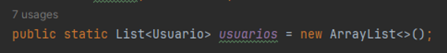

**RegisterActivity**
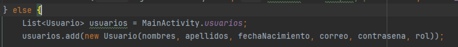

### 3. Permisos para el TTS
- > **Fecha**: Jueves 12- 08:16
- > **Contexto**: Al intentar implementar el TextToSpech o TTS, se encontró un error relacionado a los permisos que se permiten al aplicativo, para ello ingresamos algunas queries en el Manifest para poder tener acceso al TTS.

**Error en el Logcat**
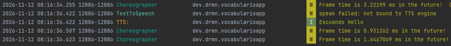

**Solución en Manifest**
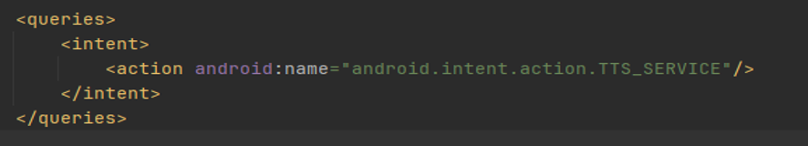

### 4. Asignación del holder en un LocalDate
- > **Fecha**: Jueves 12- 15:53
- > **Contexto**: Al intentar implementar la LocalDate para nuestro historial de actividad semanal, no logramos que funcione debido a que el setText() no permite el ingreso de una fecha tal cual. Por ello se plantea implementar un .toString() para cumplir con el parámetro del setText().

**Error en la terminal**
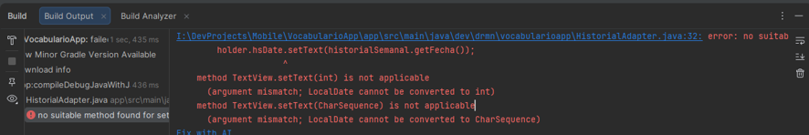

**Solución**
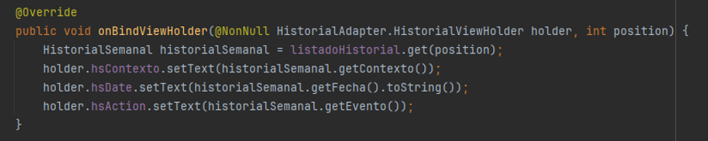

### 4. Valor entero y petición de texto
- > **Fecha**: Jueves 12- 16:10
- > **Contexto**: Seguido de este error, no logramos debido a que estamos indicando que el HomeActivity un int a algo que esperar un string, esto principalmente debido a que al settear la cantidad de días, esta tiene que convertirse en un String para poder ser usada en setText() de nuestro TextView.

**Error en Logcat**
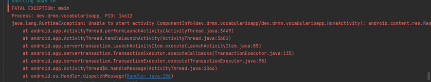

**Solución**
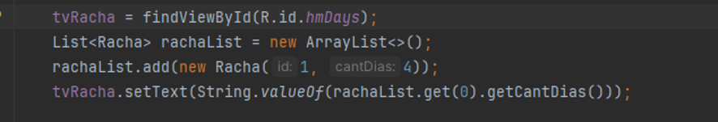