# Bitácora Semanal
## Hito Nro. 1

### 1. Constructor del Intent
- > **Fecha**: Jueves 05/11/2026
- > **Contexto**: Se presentó un error al indicar el origen y el destino de un intento implícito, a continuación el error capturado:
- >**Error**: Cannot resolve constructor 'Intent(OnClickListener, Class<RegisterActivity>)

**Antes**
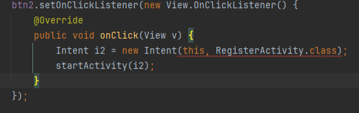

**Después**
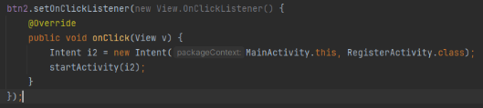

## Hito Nro. 2
### 1. Constructores de Usuarios
- > **Fecha**: Martes 10 -19:14
- > **Contexto**: Se encontró un error al momento de iniciar con la generación de la lógica de programación para el registro local de las credenciales en el register, debido a que en MainActivity solo se usan el correo y la contraseña para la validación, se generó un constructor previo antes para poder mantener la lógica anterior y poder adicionar la nueva.

**Solución**

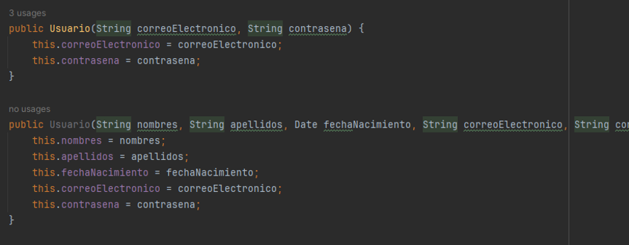

### 2. Listado privado
- > **Fecha**: Miércoles 11 - 10:55
- > **Contexto**: En la presentación del día Martes 10, se encontró que nuestra actividad de RegisterActivity si se comunicaba con la lista creada, pero que no permitía que esta misma lista sea utilizada en MainActivity, donde está nuestro Login. Así que se pensó en usar la misma lista para la verificación de los usuarios. Eso mediante un public static para poder acceder desde RegisterActivity de forma fácil y directa.

**MainActivity**
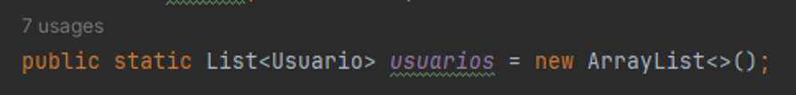

**RegisterActivity**
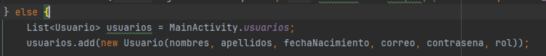

### 3. Permisos para el TTS
- > **Fecha**: Jueves 12- 08:16
- > **Contexto**: Al intentar implementar el TextToSpech o TTS, se encontró un error relacionado a los permisos que se permiten al aplicativo, para ello ingresamos algunas queries en el Manifest para poder tener acceso al TTS.

**Error en el Logcat**
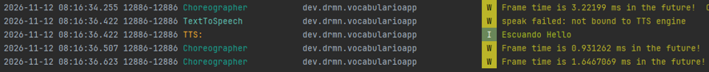

**Solución en Manifest**
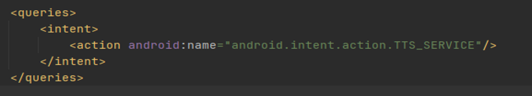

### 4. Asignación del holder en un LocalDate
- > **Fecha**: Jueves 12- 15:53
- > **Contexto**: Al intentar implementar la LocalDate para nuestro historial de actividad semanal, no logramos que funcione debido a que el setText() no permite el ingreso de una fecha tal cual. Por ello se plantea implementar un .toString() para cumplir con el parámetro del setText().

**Error en la terminal**
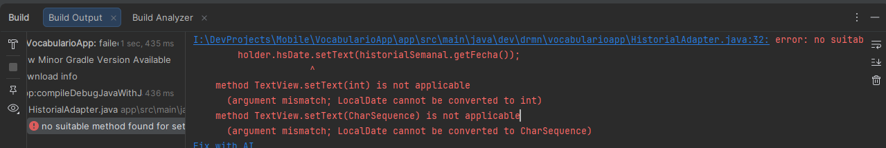

**Solución**
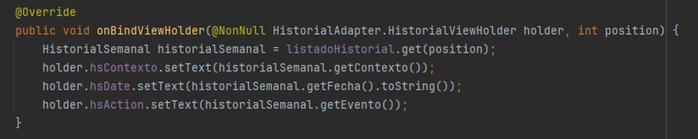

### 4. Valor entero y petición de texto
- > **Fecha**: Jueves 12- 16:10
- > **Contexto**: Seguido de este error, no logramos debido a que estamos indicando que el HomeActivity un int a algo que esperar un string, esto principalmente debido a que al settear la cantidad de días, esta tiene que convertirse en un String para poder ser usada en setText() de nuestro TextView.

**Error en Logcat**
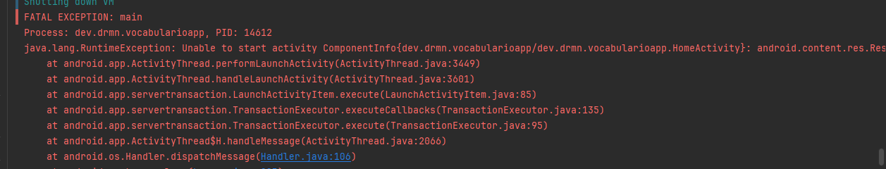

**Solución**
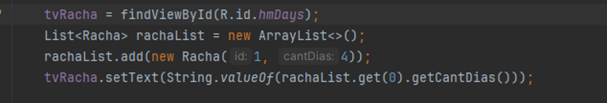

## Hito Nro. 3
### 1. Conexión a Internet
- > **Fecha**: Martes 18 - 02:55
- > **Contexto**: Se presentaron varios inconvenientes al momento previo de presentar las pruebas para la conexión de los usuarios y así dar con las cuentas registradas. Entre ellos, se tiene el error sobre la conexión a internet, un descuido en particular porque se pensaba que se había configurar en el pasado, esto debido a que se permitió los permisos para el TTS.

**LogCat**
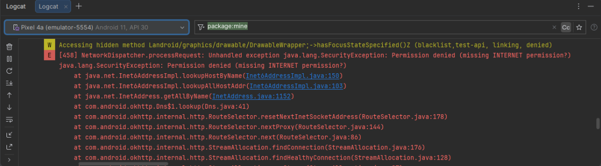
**Solución**
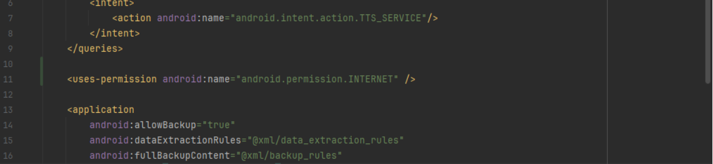

### 2. Orden secuencial en Request
- > **Fecha**: Martes 18 - 04:26
- > **Contexto**: Al momento de realizar una inserción de un nuevo usuario, teníamos el problema de que no guardaba absolutamente nada, esto llevó a probar con Bruno si la petición estaba guardando algún valor, por sorpresa no estaba guardando nada.

**Bruno**
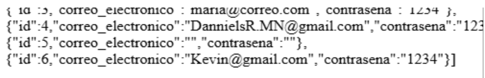
**Solución**
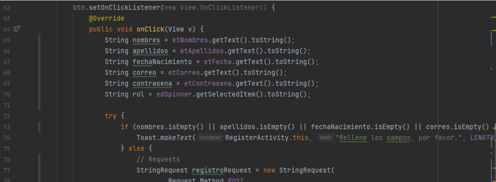

### 3. Condicional absurda
- > **Fecha**: Martes 18 - 04:31
- > **Contexto**: Adicional al punto anterior y mediante una releída del código para arreglar el anterior problema, se encontró una falla en la lógica de validación de errores, donde se podía ver antes que para que se avisara que los campos estaban vacíos, se necesitaba que todos los campos estén vacíos. Algo que por las pocas pruebas no se logró detectar a tiempo.

**Código anterior**
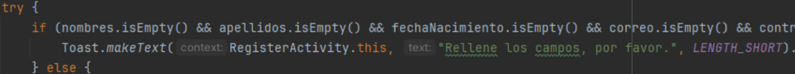
**Nuevo código**
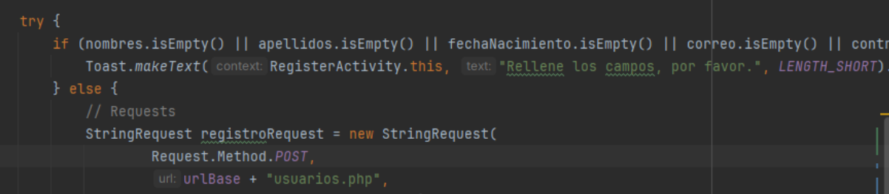

### 4. Actualización a destiempo
- > **Fecha**:  Martes 18 - 04:45
- > **Contexto**: Por último, un problema que surgió es que al momento de registrar un nuevo usuario, este no se podría usar dicho usuario debido a que el listado de comparación se obtenía en la anterior actividad y por lo que llegué a entender, esta volvía al estado anterior, algo que no hacía que se actualizara dicho listado, por ello se prefirió usar un intent que nos vuelva a dicha actividad y se vuelva a cargar nuestro listado de comparación.

**Código antes**
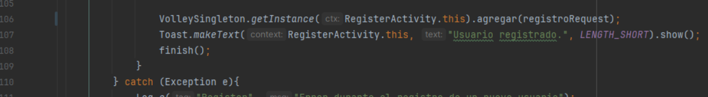
**Nuevo código**
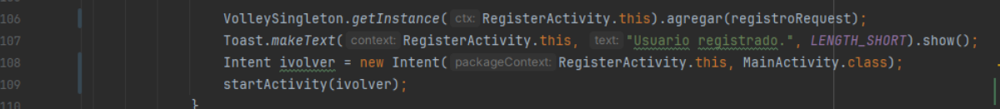

### 5. Incompatibilidad de Tipos
- > **Fecha**: Martes 18 - 16:52
- > **Contexto**: Siguiendo con el desarrollo, no se presentaron inconvenientes por el momento, hasta llegar a realizar peticiones con los tipos, ya que tenemos nuestra clase HistorialSemanal, esta recibe tanto Strings como LocalDate, siendo este último el incompatible.

**Código antes**
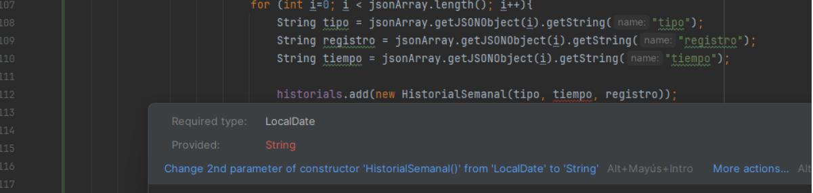
**Nuevo código**
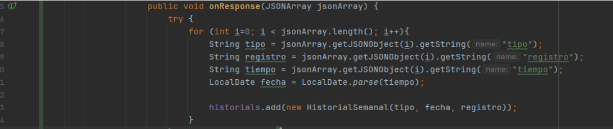

### 6. RecyclerView sin Actualizar
- > **Fecha**: Martes 18 - 17:14
- > **Contexto**: Seguido a esto, se presentó un problema respecto al RecyclerView, donde a pesar de mostrarse los registros en LogCat, este no se actualizaba o mostraba en el RecyclerView. Adelante con las pruebas.

**LogCat**
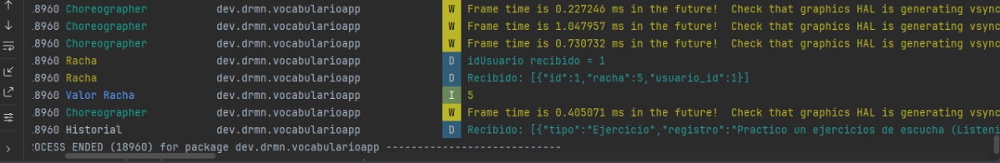
**Solución**
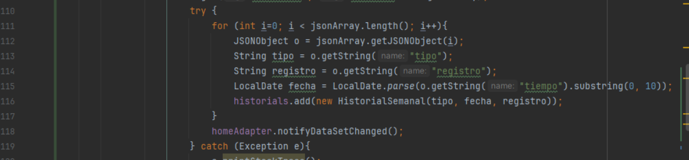