# Historial de Commits
Se presentarán los commits según los entregables o hitos a resolver, actual (Hito 2)

> Todas las horas se obtuvieron directamente de los commits y el historial del Android Studio.
>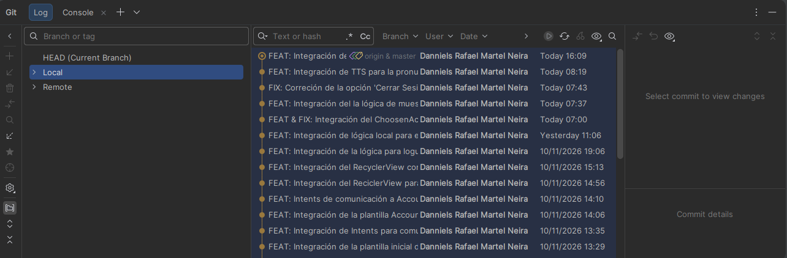

## Hito Nro. 1 (05 Noviembre)
### Inicializando el repositorio y Login (MainActivity)
> Fecha y Hora: 05/11/2026 18:30

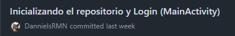

### FEAT: Integración de la estructura && Login (MainActivity)
> Fecha y Hora: 05/11/2026 18:37

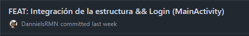

### FEAT: Integración de la RegisterActivity (Formulario)
> Fecha y Hora: 05/11/2026 18:55

### FEAT: Integración del HomeActivity (Home) y su Menubar
> Fecha y Hora: 05/11/2026 19:20

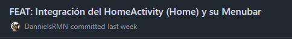

### FEAT: Integración de Intents Implícitos de MainActivity (Comunicación con RegisterActivity y HomeActivity)
> Fecha y Hora: 05/11/2026 19:28

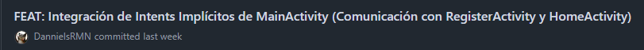

### FEAT: Integración de Intent Implícito en RegisterActivity (Destino MainActivity)
> Fecha y Hora: 05/11/2026 19:30

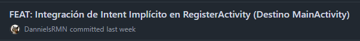

### STYLE: Cambio de color del título, opciones y control del MenuBar de HomeActivity
> Fecha y Hora: 05/11/2026 19:43

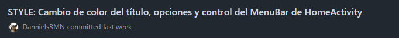

### DOCS: Integración de pruebas (imágenes) al README
> Fecha y Hora: 05/11/2026 19:49

## Previo al Hito Nro. 2 (10 Noviembre)
### FEAT: Adición de la opción en Menubar para Cerrar Sesión. (Vuelve al Login)
> Fecha y Hora: 10/11/2026 12:03

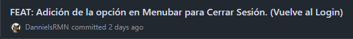

### FIX: Corrección de títulos en HomeActivity y Menu.xml para mostrar los Toast
> Fecha y Hora: 10/11/2026 12:04

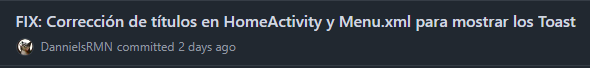

### FEAT: Implementación del diseño inicial de FlashcardActivity
> Fecha y Hora: 10/11/2026 12:22

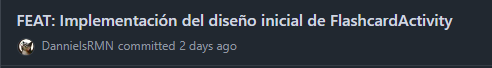

### FEAT: Integración de Intents en Menubar y Volver (finish)
> Fecha y Hora: 10/11/2026 12:28

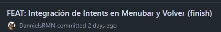

### FEAT: Integración de la plantilla inicial de ExercicesActivity
> Fecha y Hora: 10/11/2026 13:29

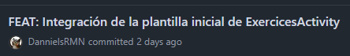

### FEAT: Integración de Intents para comunicar ExercicesActivity y Volver (finish)
> Fecha y Hora: 10/11/2026 13:35

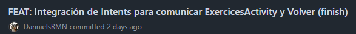

### FEAT: Integración de la plantilla Account
> Fecha y Hora: 10/11/2026 14:06

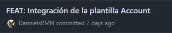

### Intents de comunicación a AccountActivity y Volver (Finish)
> Fecha y Hora: 10/11/2026 14:10

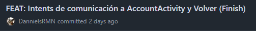

### FEAT: Integración del ReciclerView para mostrar palabras del vocabulario
> Fecha y Hora: 10/11/2026 14:56

### FEAT: Integración del RecyclerView con varios ejemplos junto a Activity & XML
> Fecha y Hora: 10/11/2026 15:13

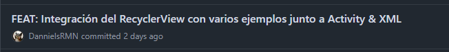

## Hito Nro. 2 (10 Noviembre)

### FEAT: Integración de la lógica para loguearse
> Fecha y Hora: 10/11/2026 19:06

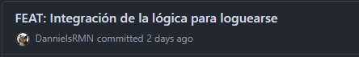

## Post al Hito Nro. 2 (11 Noviembre)
### FEAT: Integración de lógica local para el registro de usuario y su próximo logueo.
> Fecha y Hora: 11/11/2026 11:06

## Post al Hito Nro. 2 (12 Noviembre)
### FEAT & FIX: Integración del ChoosenActivity para elegir idioma y dificultad del usuario & Correción MainActivity -> ChoosenActivity -> HomeActivity
> Fecha y Hora: 12/11/2026 07:00

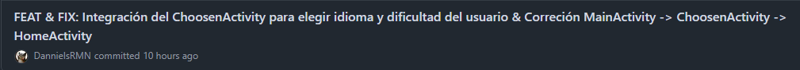

### FEAT: Integración del la lógica de muestra de la palabra y significado (Random) en Flashcards
> Fecha y Hora: 12/11/2026 07:37

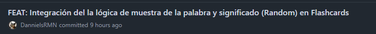

### FIX: Correción de la opción 'Cerrar Sesión' para redirigir a MainActivity
> Fecha y Hora: 12/11/2026 07:43

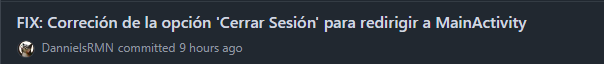

### FEAT: Integración de TTS para la pronunciación de las palabras
> Fecha y Hora: 12/11/2026 08:19

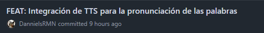

### FEAT: Integración del historial semanal y la racha de actividad (Progreso diario)
> Fecha y Hora: 12/11/2026 16:09

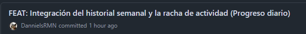
